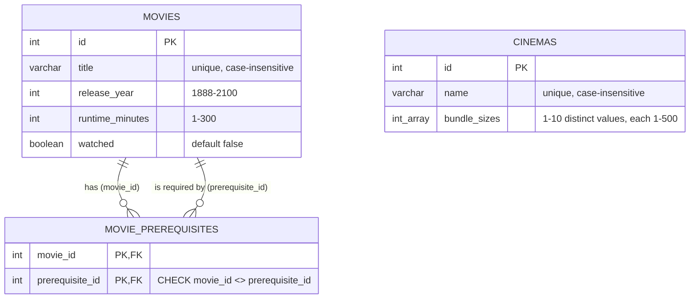

# Doomsday Ready

A small full-stack app that helps MCU fans plan their rewatch before *Avengers: Doomsday* and book an opening-night watch party.

Monorepo:

| Path | What | Stack |
|------|------|-------|
| [`server/`](server) | REST API (`/api`) | Node 22, TypeScript, Express, PostgreSQL, Redis, Zod |
| [`client/`](client) | Web UI (3 views) | Next.js 14 (App Router), React 18, TypeScript |
| [`docker-compose.yml`](docker-compose.yml) | Runs everything | postgres, redis, server, client |

## Run it (one command)

```bash
docker compose up --build
```

- Web app: <http://localhost:3001>
- API: <http://localhost:4000/api> (health: <http://localhost:4000/health>)

On first start the database is seeded with the sample MCU movies and four cinemas (set `SEED=false` to disable). Reset all data with `docker compose down -v`.

### Run locally without Docker for the apps

```bash
docker compose up -d postgres redis      # or your own Postgres + Redis
cd server && npm install && npm run dev  # :4000 (env: see server/src/config.ts)
cd client && npm install && npm run dev  # :3000, proxies /api -> :4000
cd server && npm test                    # unit tests for the algorithms
```

Postgres/Redis are only reachable inside the compose network by default; to use them from your host add `ports` to those services or point `DATABASE_URL` / `REDIS_URL` at your own instances.

## Data model



Movie prerequisites form a directed graph (an edge table, many-to-many from `movies` to itself). Cinemas are independent; their bundle sizes are stored as an integer array.

## API

All under `/api`. Errors look like `{ "error": { "code", "message", "details?" } }`.

| Method & path | Purpose |
|---|---|
| `POST /movies` | Create a movie (or an array of up to 50, atomically). Body: `title`, `releaseYear`, `runtimeMinutes`, optional `watched`, optional `prerequisites` (ids, or titles) |
| `GET /movies` | List movies (with prerequisite ids) |
| `PATCH /movies/:id` | Update any of `title`, `releaseYear`, `runtimeMinutes`, `watched`, `prerequisites` |
| `GET /movies/:id/rewatch-order` | `{ target, order[], totalCount, watchedCount, remainingRuntimeMinutes }` |
| `POST /cinemas` | Create a cinema: `name`, `bundleSizes` |
| `GET /cinemas` | List cinemas |
| `GET /cinemas/:id/booking?groupSize=6` | `{ possible, totalBundles, bundles: [{size,count}], message, ... }` |
| `GET /health` (outside `/api`) | DB + Redis status |

Status codes: `201` created, `400 VALIDATION_ERROR`, `404`, `409 CIRCULAR_DEPENDENCY` / `DUPLICATE`, `413`, `415`, `429 RATE_LIMITED`.

## How the features work

**Circular dependencies (Feature 1).** On any change to a movie's prerequisites the API loads the dependency graph and walks (iterative DFS) from each *new* prerequisite through *its* prerequisites. If the walk reaches the movie being edited — or a prerequisite is the movie itself — the request is rejected with `409 CIRCULAR_DEPENDENCY` and nothing is saved. The check and write run in one transaction under a Postgres advisory lock so two concurrent requests cannot jointly create a cycle. A DB `CHECK` also forbids direct self-edges.

**Rewatch order.** Iterative depth-first post-order from the target over the prerequisite edges, with a visited set: every movie appears once and after all its own prerequisites; the target is excluded. Siblings are visited in ascending id so output is deterministic. `watchedCount` and `remainingRuntimeMinutes` (sum of unwatched runtimes) are computed from that list.

**Booking quote (Feature 2).** Classic "minimum coins" dynamic programming over seat counts `0..groupSize` (at most 10,000 × 10 steps), then backtracking to count each bundle size. Bundle sizes are tried largest-first so ties resolve to bigger bundles deterministically. No exact combination → `possible: false` (HTTP 200, since "not possible" is a valid answer).

Both algorithms are hand-written ([`graph.ts`](server/src/lib/graph.ts), [`booking.ts`](server/src/lib/booking.ts)) with no libraries, and are covered by tests using the brief's examples (`cd server && npm test`).

## Redis

1. **Read cache** for `GET` endpoints (movies list, rewatch order, cinemas list, booking quotes), 60 s TTL, with an `X-Cache: HIT|MISS` response header. Each resource has a version counter (`ver:movies`, `ver:cinemas`); every write bumps it, which instantly invalidates all cached entries for that resource (old keys just expire). So a `PATCH` marking a movie watched is reflected immediately.
2. **Rate limiting** counters (shared across API replicas).

If Redis is down the API keeps working — cache is skipped and rate limiting fails open.

## Security

General (all endpoints)
- **Input validation** with strict Zod schemas: types, ranges (runtime 1–300, group size 1–10,000, bundle 1–500, 1–10 distinct bundle sizes), string lengths, and **unknown fields are rejected**. Path/query ids and `groupSize` are validated as plain integers before use.
- **SQL injection**: every query is parameterised; no string-built SQL with user input.
- **Rate limiting** (Redis): 300 req/min/IP overall and a stricter **40 writes/min/IP** (`POST`/`PATCH`); returns `429` with `Retry-After`. Configurable via env.
- **Helmet** security headers, `x-powered-by` disabled.
- **CORS allow-list** (`CORS_ORIGINS`), only `GET/POST/PATCH` and the `Content-Type` header.
- **Safe errors**: stack traces/DB errors are logged server-side only; clients get a generic message.
- Postgres statement timeout (5 s), connection pool cap, non-root containers, health checks, graceful shutdown.

POST/PATCH specifically
- **JSON only**: other content types get `415` — blocks cross-site HTML-form / `text/plain` "simple request" CSRF posts (JSON forces a CORS preflight, which the allow-list denies).
- **Body size limit** 20 KB (`413`), malformed JSON → `400`, bulk create capped at 50 items, prerequisite list capped at 50.
- **Mass-assignment protection**: strict schemas mean clients cannot set `id`, `created_at` etc.
- **Uniqueness enforced by the database** (case-insensitive unique indexes) so races cannot create duplicates → `409 DUPLICATE`.
- **Atomic writes**: bulk creates and prerequisite updates run in a single transaction (all or nothing), serialised by an advisory lock to prevent concurrent cycle creation.
- Unknown prerequisites are rejected (`400 UNKNOWN_PREREQUISITE`) rather than silently ignored.

Not included (no auth was in scope): user accounts / API keys. For a real deployment I would put the write endpoints behind authentication and TLS.

## Decisions & assumptions

- Release year is accepted in 1888–2100 (the brief gives no range).
- Titles and cinema names are unique **case-insensitively** ("iron man" = "Iron Man").
- `prerequisites` can be given as ids or exact titles; setting it **replaces** the whole list (send `[]` to clear it).
- Deleting movies/cinemas is out of scope (not in the brief).
- Next.js proxies browser calls from `/api/*` to the API container (`next.config.mjs` rewrites), so the browser only talks to one origin and no CORS is needed in the UI path. The API target is baked at build time (`API_URL` build arg).
- Quote ties between equally small combinations resolve to the one using larger bundles.

## How AI was used

I used Claude (Claude Code) as a pair-programmer: to read the brief, scaffold the monorepo, Dockerfiles and compose file, write the UI, and draft this README. I reviewed the output, and verified the behaviour against the brief's examples with the unit tests and by running the API against real Postgres and Redis (including the `409 CIRCULAR_DEPENDENCY` and booking examples). Core algorithms for features 1 and 2 use no libraries.

## Project structure

```
.
├── docker-compose.yml
├── server/            # Express + TypeScript API
│   ├── Dockerfile
│   ├── src/ (app, routes/, lib/{graph,booking}.ts, db.ts, redis.ts, middleware.ts, seed.ts)
│   └── test/
└── client/            # Next.js app
    ├── Dockerfile
    └── src/ (app/, components/{Movies,RewatchPlan,Booking}.tsx, lib/api.ts)
```
